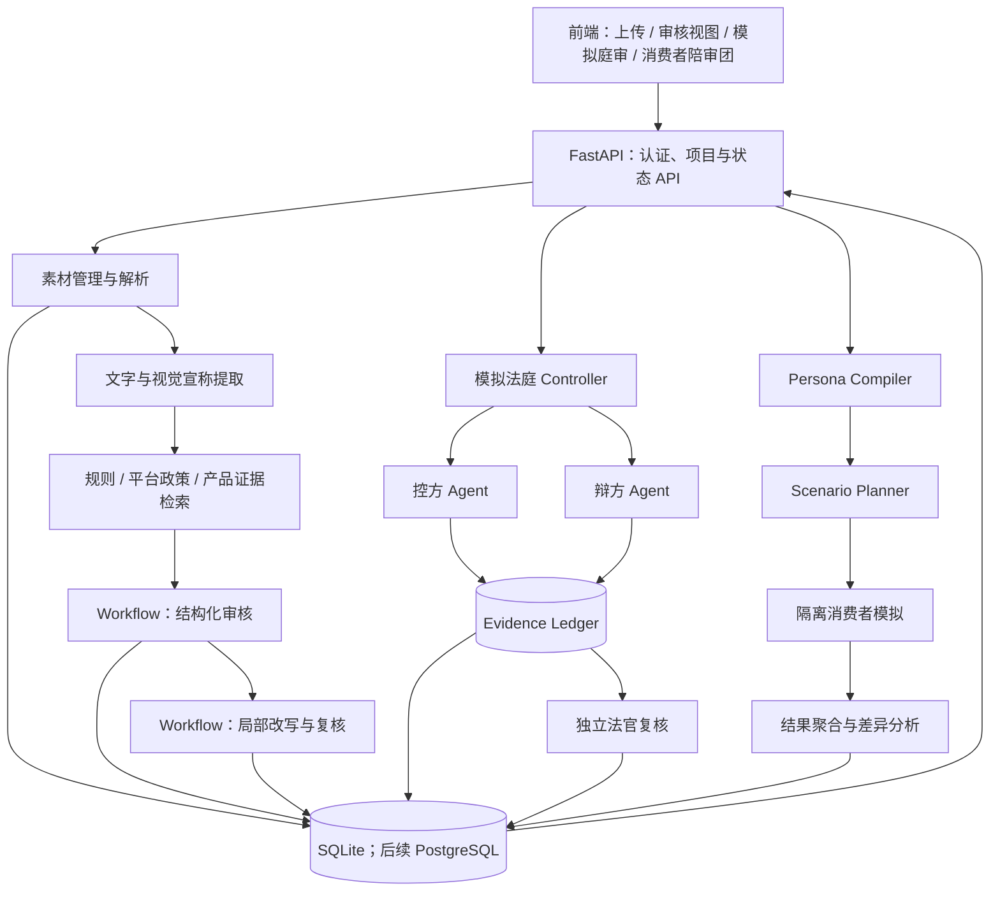

# 架构与模块边界

首版采用 React 前端、FastAPI 后端和 SQLite。主审核由固定流程控制；模拟法庭独立管理控辩和证据台账；消费者模拟按需运行。具体业务规则见[产品说明](../AI%20Marketing%20Court%20V1.0.md)。

`PolicyStore` 与企业提供的 `ProductEvidenceStore` 分开管理。模型输出先经过结构化校验和引用核查，才可写入业务状态。素材、数据库、密钥和客户 Persona 不进 Git。
