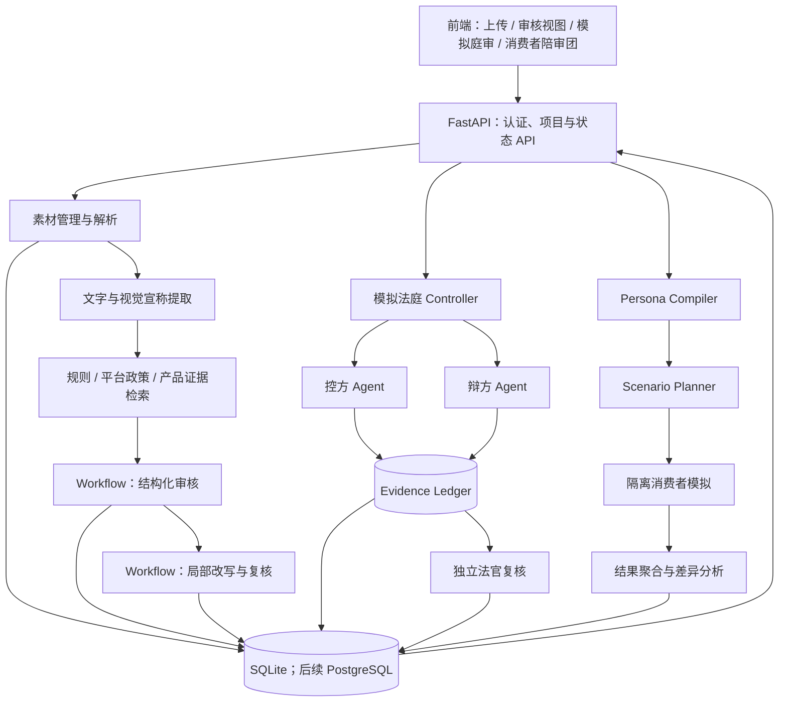

# 架构与模块边界

首版采用 React 前端、FastAPI 后端和 SQLite。主审核由固定流程控制；模拟法庭独立管理控辩和证据台账；消费者模拟按需运行。具体业务规则见[产品说明](../AI%20Marketing%20Court%20V1.0.md)。

## 当前演示实现

一个 FastAPI 进程同时提供审核、庭审与远端已有消费者模拟 API，React 通过 Vite 代理访问 `/api`、`/health` 与 `/jury`。审核用后台任务和每秒轮询展示实际阶段；原计划中的 SSE 尚未实现。

图片经过 MIME、解码、尺寸与体积校验后保存在本地。PaddleOCR 提供文字与四点坐标，文字模型提取原文宣称，程序关联最小可靠文字区域。当前仅检索英国 CMA 环保指引的两条版本化摘录；引用不存在时拒绝保存模型结论。

SQLite 保存项目、素材版本、审核、任务检查点、改写与庭审。审核与改写结果采用追加版本；数据库事务同时提交新结果与任务完成状态。服务启动时将未完成任务标记为中断，重试复用已保存的 OCR 和模型步骤。

庭审沿用压缩包中的固定两轮控制器。案件保存独立快照，四次控辩后由单独的法官调用复核；法官上下文不携带初始审核立场字段。返回来源 ID 必须属于案卷，裁判不覆盖原审核。

`CourtInput` 是审核与庭审边界；`Review` 是前端读取的完整审核版本；`Task` 返回状态、阶段、事件和结果 ID，内部检查点不向前端暴露。新增素材的审核只允许实时模式，`/api/demo` 单独导入明确标注的预设数据。

消费者模拟沿用远端模块，保存独立 SQLite 文件，通过 `/jury` 独立页面使用。审核、庭审与消费者模块共享 `core/model_api.py` 模型适配器；旧导入路径保留兼容导出。消费者报告与广告审核记录尚未自动关联。

## 后续产品架构

下图包含尚未接入的图像语义与消费者模拟模块，表示后续演进方向。

`PolicyStore` 与企业提供的 `ProductEvidenceStore` 分开管理。模型输出先经过结构化校验和引用核查，才可写入业务状态。素材、数据库、密钥和客户 Persona 不进 Git。
